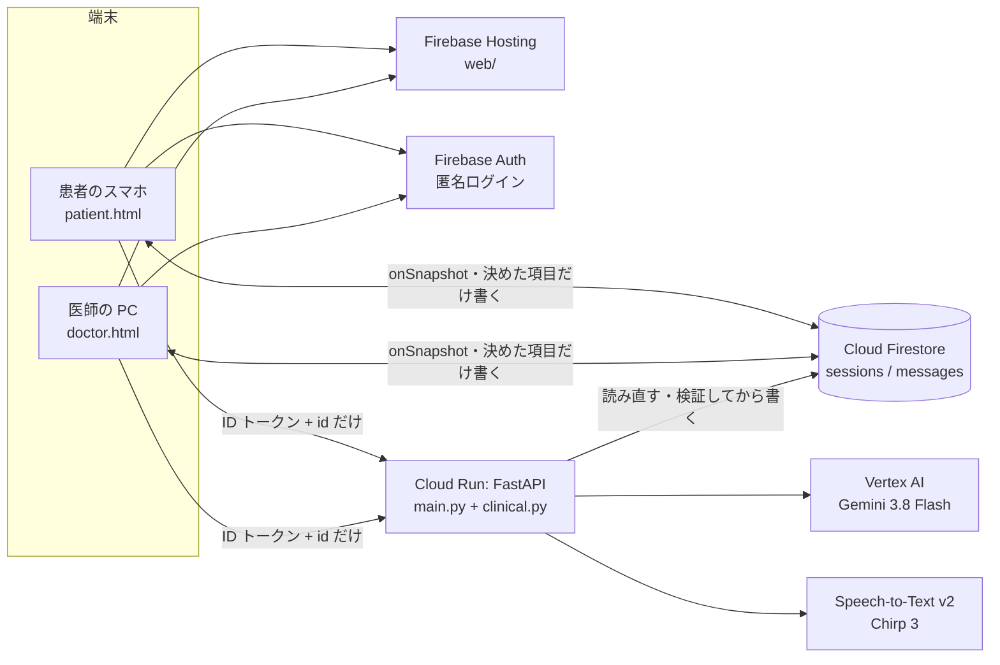
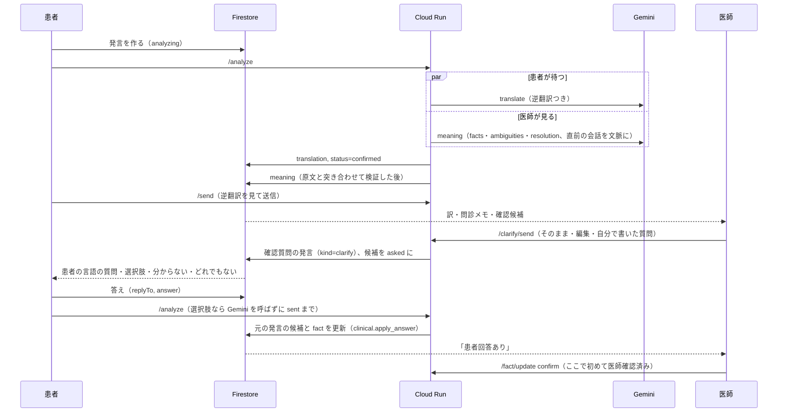
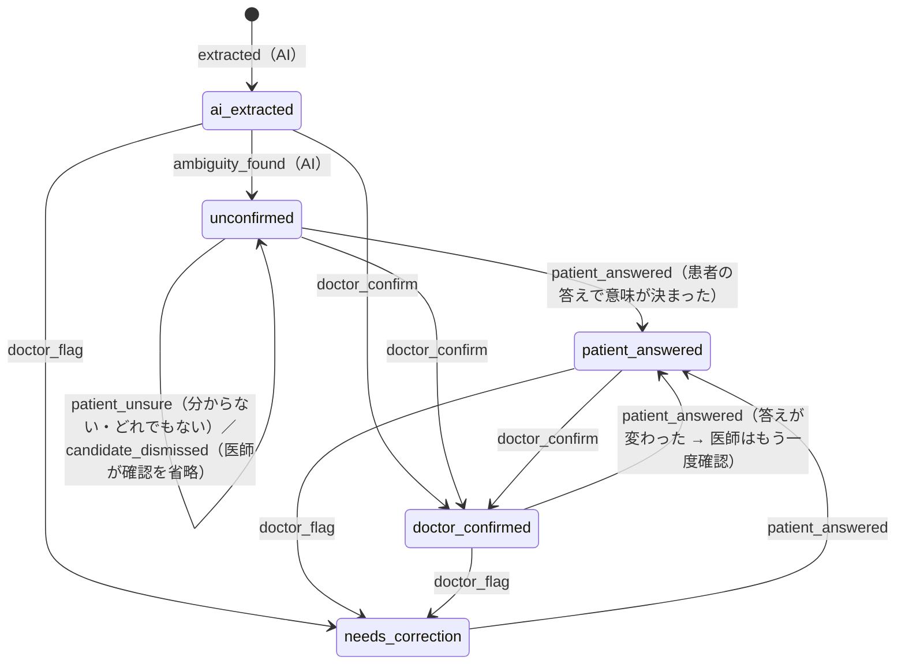

# UNSAID のアーキテクチャ

## 全体



- 端末が Firestore に書けるのは「発言を作る」「患者が答える」「既読」など決めた項目だけ（[firestore.rules](firestore.rules)）。
- 翻訳・問診メモ・確認候補・理解の判定・状態の変更は **Cloud Run だけ**が書く。API は id だけを受け取り、本文と言語は Firestore から読み直す。
- 画面は API の応答を待たず、Firestore の変化（onSnapshot）で描き直す。

## データ（`sessions/{sid}/messages/{mid}`）

すべての発言・確認質問・答え・理解の確認は同じ `messages` に入る。だから「診察を終える」（`/end`）と TTL（`expireAt`）でまとめて消え、画面は1つの購読で全部を見られる。

| 種類 | 作る人 | 主なフィールド |
|---|---|---|
| 患者の発言 | 端末（`from: patient`） | `original`（原文）、`translation`（訳・逆翻訳）、`meaning`（下）、`facts`（旧い形。患者の「自分のメモ」用） |
| 医師の発言 | 端末（`from: doctor`） | `original`、`translation` |
| 確認質問 | API（`kind: clarify`） | `original`（医師の言語の質問）、`translation.text`（患者の言語）、`clarify {source_message_id, candidate_id, fact_ids, source_quote, options, options_doctor, fixed, edited, last_answer_id}` |
| 理解の確認の依頼 | API（`kind: teachback`） | `teachback {explanation_id, status, answer_message_id, result, history}` |
| 患者の答え | 端末（`replyTo`, `answer {type, index?}`） | 確認質問への答えは `meaning.resolution`、理解の確認への答えは `teachback_result` |

### meaning（Meaning Engine の結果。`clinical.build_meaning` が検証した後の形）

```text
meaning.status              ready | error（解析だけ失敗。原文と訳は残る）
meaning.facts[]             fact_id, utterance_id(= mid), category, normalized_meaning(医師の言語),
                            source_quote(原文に実在), span_start/span_end, source_language,
                            evidence_status(exact | normalized), polarity(present | denied | uncertain),
                            about_fact_id, status, clarification_status, resolved_meaning, timestamp, history[]
meaning.candidates[]        candidate_id, source_quote, span, meaning_doctor, reason, unresolved,
                            question_patient, question_doctor, options_patient[], options_doctor[],
                            priority, rank, fact_ids[], origin(ai | doctor), status, question_message_id, answers[], history[]
meaning.resolution          確認質問への自由回答のとき: applies, resolves(yes | partly | no), meaning_doctor, source_quote
meaning.rejected[]          採用しなかった AI の出力（原文に無い引用・重複・重要でない・もう聞いた・患者向けの文に日本語…）
```

`source_text` = その発言の `original`、`translated_text` = `translation.text`（`utterance_id` でたどる）。
「言及なし」は fact が無いこと（画面は既往歴・服薬・アレルギーについて「言及なし」と出す）、「患者が否定した」は `polarity: denied`、「未確認」は `status: unconfirmed`。

## 流れ

### 患者の発言（シナリオ A）



### 理解の確認（シナリオ B・C）

医師の説明（`sent`）→ `/teachback/start`（依頼文は固定。Gemini を呼ばない）→ 患者は話す画面で自分の言葉で答える（`replyTo`）→
`/analyze` が翻訳と比較（`compare_understanding`）を並列に → 患者が逆翻訳を見て `/send` → 依頼の `teachback.status = assessed`、結果を医師に表示 →
医師が「再説明する」（文案を入力欄へ。`needs_reexplain`）か「理解を確認済みにする」（`doctor_confirmed`）。再説明した発言に、もう一度「理解を確認」。

## 状態遷移（clinical.py）

状態は明示的なイベントでしか変わらない。表に無い遷移はサーバーが 409 で断る。
**AI と患者のイベントで「医師確認済み」「要修正」になる遷移は無い**（`tests/test_clinical.py` で表全体を検査）。



- 確認候補: `proposed → held / dismissed / asked → answered / unresolved`（`unresolved` は聞き直せる。`dismissed` は戻せる）。
- 理解の確認: `asked → answered → assessed → doctor_confirmed / needs_reexplain`。AI の判定（`assessed`）は確定ではない。
- 全体の判定（`overall`）はモデルに任せず、各点の判定から計算する：mismatch が1つでも → `inconsistent`、unclear → `unclear`、missing だけ → `partial`、全部 match → `consistent`。
  食い違いの根拠（患者の言葉の引用）を示せない mismatch は `unclear` に下げる。

## Gemini の使い方

| 呼び出し | プロンプト / スキーマ | いつ | 患者は待つか |
|---|---|---|---|
| `translate` | `translate_system.txt` / `translate.json` | 全発言。確認質問への答えは質問を文脈に | 待つ（1本） |
| `meaning` | `meaning_system.txt` / `meaning.json` | 患者の発言（直前 6 発言を医師の言語で文脈に、もう聞いた語、答えている質問） | 待たない（翻訳と並列） |
| `compare_understanding` | `teachback_system.txt` / `teachback.json` | 理解の確認への答え | 待たない（翻訳と並列） |
| `translate`（医師の質問） | 同上 | 医師が編集・自作した確認質問 | — |
| `clarify` / `facts` | 従来のもの | `CLARIFY_MODE=patient`（従来の流れ）のときだけ | — |

- すべて `response_json_schema` で形を固定し、サーバーでも同じスキーマで `jsonschema` 検証する。
- 事実の抽出・曖昧さ・確認への答えの解釈は1回の呼び出しにまとめた（費用と時間）。役割は検証側（`build_meaning`）で分けてテストしている。
- 選択肢・「分からない」「どれでもない」で答えたときは Gemini を呼ばない（訳は確認質問を作ったときにある）。
- 遅い回は5秒で同じ依頼をもう1本（hedged request）、429/5xx は間隔を空けて再試行、続けば予備のモデル（`FALLBACK_MODEL`）。

## 非同期と順番

- 1つの発言の処理は「処理中」の印（`lockedUntil`）で1本に限る（二重押し・「もう一度」）。
- 元の発言の `meaning` を変える操作（医師の操作・答えの反映）は Firestore のトランザクションで読んでから書く。
- 答えの反映（`_apply_reply`）は「患者が送信した」と「解析が終わった」の両方が揃ったときに1回だけ効く。どちらが先でも結果は同じ（`answers` に同じ答えは2回入らない。`tests/test_flow.py`）。
- 未確定の音声認識は Firestore に書かない（端末の入力欄に入れ、本人が直して送ったものだけが発言になる）。送る前（`confirmed`）・「違う」で戻した発言の情報は問診メモに入れない。

## 通信

- Firestore の購読は切れても自動で再接続し、端末の書き込みは後から届く。画面の緑の点と見出しは、オフラインのとき灰色と「通信が切れています」に変わる（`watchConnection`）。
- API は 45 秒で諦めて「もう一度」を出す（発言は Firestore にあるので消えない）。25 秒進まない発言にも「もう一度」（`stuckWatch`）。
- 音声認識に失敗したら文字入力を案内する。

## 環境の分け方

| 環境 | 画面 | API | Firestore | AI |
|---|---|---|---|---|
| 本番（main） | `unsaid-devfest.web.app` | Cloud Run `unsaid-api` | `(default)` | Gemini |
| ステージング（この branch） | Hosting のプレビューチャンネル `unsaid-devfest--<name>-*.web.app` | Cloud Run `unsaid-api-staging`（`FIRESTORE_DATABASE=staging`） | 名前付きデータベース `staging` | Gemini |
| ローカル | `python -m devtools.devserver` | 同じ `main.py` をメモリ上のデータで | メモリ（`devtools/fakestore.py`） | 偽物（`devtools/fake_ai.py`） |

画面はホスト名でステージングかを決める（`web/firebase-config.js`）。手順は [docs/staging.md](docs/staging.md)。
