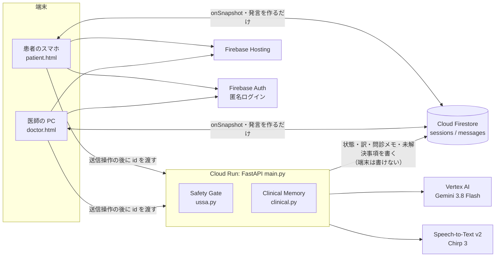
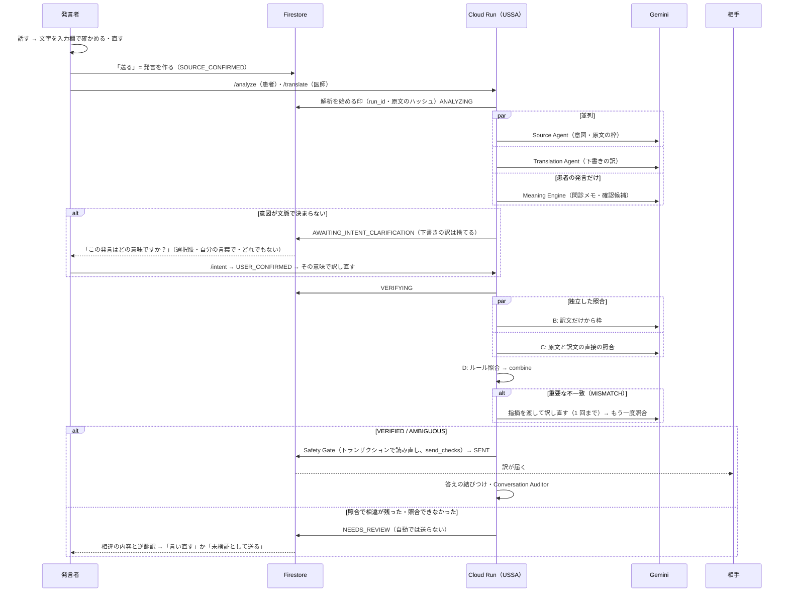
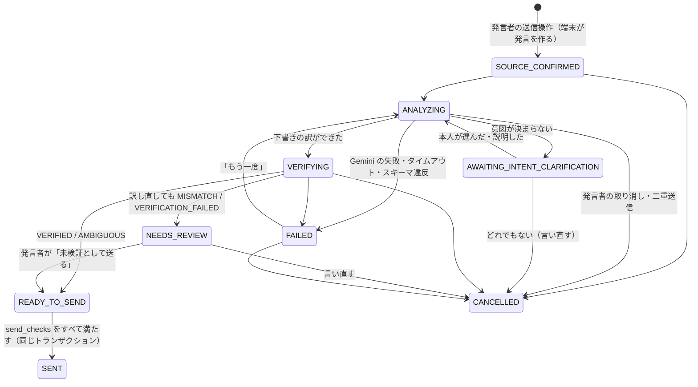

# UNSAID のアーキテクチャ — UNSAID Semantic Safety Architecture（USSA）

言語の壁がある診察で起こる「伝わったつもり」（音声認識の誤り・発話意図の曖昧さ・訳での意味の欠落・説明不足・理解の不一致・会話全体の矛盾）を、
発言ごとと会話全体の両方で見つけ、確認で解消できるものは解消し、解消できないものは**確定させずに人に見せる**。

## 1. 全体

- 端末が Firestore に書けるのは「発言を作る（＝送信操作）」「医師の既読」「患者の答えの replyTo / answer」だけ。**`status: sent` を書けるのはサーバーだけ**（[firestore.rules](firestore.rules)）。
- 訳・意図・照合・問診メモ・未解決事項・送信の状態はすべて Cloud Run が書く。API は id だけを受け取り、本文と言語は Firestore から読み直す。
- 画面は API の応答を待たず、Firestore の変化（onSnapshot）で描き直す。

## 2. 論理コンポーネント

別のマイクロサービスや LLM インスタンスではなく、同じ FastAPI の中の役割として実装している。

| コンポーネント | 何をするか | 実装 |
|---|---|---|
| Speech & Input Layer | 音声 → 文字は入力欄に入るだけ（**送らない**）。発言者が確かめ・直し・消し・録り直して「送る」 | `stt.py`、`web/stt.js`、各画面の入力欄と消去ボタン |
| Source Agent | 発言者の言語と直前の会話から、発話意図・発話行為・肯定否定・主体・行為・対象・条件・日時・数量・不確実性を解析し、意味の枠（frame）を作る。意図が文脈で決まるか判定 | `unsaid_ai.source_agent`、`prompts/source_system.txt`、`ussa.build_intent` |
| Translation Agent | 原文から相手の言語へ**直接**訳す。直前の会話・本人が確認した意図・照合の指摘（訳し直しのとき）を渡す。未確認の AI の推測は渡さない | `unsaid_ai.translate`、`main._draft` |
| Semantic Bridge | 言語に依存しない意味の枠（列挙・数値・正規化した日時）。原文の枠（A）と訳文の枠（B）を比べられる | `ussa.build_frame`・`compare_frames`、`schemas/source.json`・`frame_extract.json` |
| Verification Engine | A: 原文の枠／B: 訳文**だけ**から独立に取った枠／C: 原文と訳文の直接の照合（LLM）／D: 数・時刻・日付・曜日・否定のルール照合 → VERIFIED / MISMATCH / AMBIGUOUS / VERIFICATION_FAILED。重要な不一致は訳し直して再照合（上限 1 回）、残れば発言者の確認へ | `main._verify`、`ussa.rule_check`・`combine`、`prompts/frame_system.txt`・`verify_system.txt` |
| Safety Gate | 送信の状態遷移と、送る直前の最終チェックを**コードで**行う。LLM の「安全」は根拠にしない | `ussa.GATE_TRANSITIONS`・`send_checks`、`main._deliver` |
| Clarification Manager | ① 翻訳前の発話意図の確認（発言者に）② 翻訳後の診療情報の確認（医師が選んで患者に）を分ける | `/intent`、`/clarify/send`、`clinical.py` |
| Conversation Auditor | 会話全体の矛盾・理解の相違・未回答・説明不足を、最新の発言・記憶（重要な発言の要点と枠）・未解決事項から**差分で**見つけ、未解決事項として追跡 | `main._audit`、`ussa.merge_audit`・`cross_check`、`prompts/audit_system.txt` |
| Clinical Memory | 原文の根拠つきの問診メモ（前回の Meaning Engine）と、その状態・履歴・カルテ用の文章 | `clinical.py`、`web/clinical.js` |

## 3. 発言の流れ（医師 → 患者、患者 → 医師で同じ）

- **送信操作は発言者の1回だけ。** 訳文を発言者に承認させない（発言者は相手の言語を読めない）。意図の確認と照合で相違が残ったときだけ、追加の確認が出る。
- 下書きの訳は Source Agent と並列に作り、意図が決まれば使う（決まらなければ捨てる）。患者が待つのは「意図と訳（並列）＋照合（並列）」の2段。
- 選択肢で答えた確認質問は Gemini を呼ばない（医師が送った質問の対訳を使う）。照合の記録は `PRETRANSLATED`（照合はしていないと正直に記録）。

## 4. Safety Gate

### 状態（`messages.gate.state`）

`DRAFT` は送信操作の前（端末の入力欄の中）なので Firestore には無い。`SENT` に入るのは `READY_TO_SEND` からだけで、`READY_TO_SEND` に入るのは照合（`VERIFYING`）か発言者の確認（`NEEDS_REVIEW`）からだけ（`tests/test_ussa.py` で表全体を検査）。

### 送る直前の最終チェック（`ussa.send_checks`）

トランザクションの中で発言を読み直し、次をすべて満たすときだけ `SENT` にする。1つでも欠ければ送らない（`FAILED`、理由を履歴に残す）。

| チェック | 中身 |
|---|---|
| sender | 送る人がその発言の発言者 |
| explicit_send | 発言者の送信操作（発言を作った）がある |
| source_fixed | 原文が解析した時のまま（ハッシュが一致） |
| stale_run | 今の解析（run_id）の結果である。取り消し・別の解析・古い解析の結果は送らない |
| state | `READY_TO_SEND`（取り消し・送信済み・確認待ちではない） |
| intent | 意図が `RESOLVED`（AI の解釈）か `USER_CONFIRMED`（本人の確認） |
| verification | 照合が `VERIFIED` / `AMBIGUOUS` / `PRETRANSLATED`、または発言者が「未検証として送る」を選んだ |
| translation | 送る訳がある |

問診が終わって session が無ければ送らない。端末から `status: sent` を書くことはルールで禁止している（Safety Gate を迂回できない）。

### 例外のときの動き

| 起きたこと | 動き |
|---|---|
| Gemini のタイムアウト・429・5xx | 再試行（hedged request・間隔を空けた再試行・予備のモデル）。尽きたら `FAILED`、原文は残り「もう一度」 |
| JSON Schema 違反 | その出力は使わない。Source Agent なら `FAILED`、照合なら `VERIFICATION_FAILED` → 発言者の確認 |
| 照合の LLM が失敗 | 1 回だけ照合をやり直す。失敗が続けば `VERIFICATION_FAILED` → 自動では送らない |
| 古い非同期処理が後から終わった | run_id が違うので何も書かない |
| 二重クリック・重複イベント | 同じ発言は処理中の印（`lockedUntil`）で 409。同じ人が同じ文を 10 秒以内にもう一度送ったら2つ目を取り消し |
| 発言者が意図の確認に答えない | `AWAITING_INTENT_CLARIFICATION` のまま。時間が経っても送らない。医師は「未検証の内容を見る」で原文を見られる |
| ネットワーク切断・再接続 | Firestore の購読は自動で再接続。画面の点が灰色に。API は 100 秒で諦め「もう一度」 |
| 診察終了 | session と発言を消す。解析中の発言は送られない |

### 緊急時: 未検証の原文の共有

AI の確認が終わるまで重要な訴えを医師から完全に隠すのは危険なので、医師は患者の未着の発言に「未検証の内容を見る」を押せる（`/reveal`）。
原文・言語・「未検証・意味は未確定」・（あれば）未検証の機械翻訳を、黄色の枠で出す。見たことは `gate.revealed` に記録し、問診メモには入れない。AI の緊急度判定はしない。

## 5. Semantic Bridge と Verification Engine

意味の枠（`ussa.build_frame`）: `speech_act` `polarity` `modality` `certainty` `actor` `action` `object` `negated` `times`（`day+0` `week+1` `HH:MM` `P3D` など正規化）`quantities`（数値＋単位）`frequency`（回数／期間）`conditions` `medical_entities`（有無つき）`unresolved_slots`、
と原文の根拠（`evidence`: 原文に実在する引用だけ）。分からない項目は分からないまま（`none` / `unknown` / 空）。
原文・訳文・枠・根拠・未確認事項をすべて残し、**枠だけを正解として扱わない**。

照合の統合（`ussa.combine`）:

| 層 | 強い証拠（あれば MISMATCH） | 弱い・中くらいの証拠 |
|---|---|---|
| D ルール | 数（2 以上・小数）・時刻・相対日付・曜日の違い | 否定の字面の有無（枠で肯定否定が一致すれば捨てる） |
| A/B 枠の比較 | 禁止⇔許可、同意⇔拒否、質問⇔陳述、量・回数・日時・時間帯（朝⇔夜）の違い、条件の欠落、症状の有無の反転、同じ行為の肯定⇔否定 | 主体・確からしさの違い、行為が違う肯定否定 |
| C 直接の照合（LLM） | 原文か訳文に実在する引用を伴う critical の指摘 | 引用の無い指摘・minor |

強い証拠は、LLM が「同じ意味」と言っても MISMATCH のまま（**複数の LLM の一致を正しさの証明として扱わない**）。中くらいだけなら、C も同じ意味と言えば VERIFIED、言わなければ AMBIGUOUS（送るが、医師の画面に「訳の一部が未照合」と小さく出す）。
B には原文も翻訳側の判断も渡さない。C には本人が確認した意図だけを渡す。

## 6. Clarification Manager（2 種類の確認）

| | 発話意図の確認（Translation Intent Clarification） | 診療情報の確認（Clinical Information Clarification） |
|---|---|---|
| いつ | 翻訳の**前** | 翻訳の**後**（届いた後） |
| 誰に | 発言者本人（医師・患者どちらでも） | 医師が選んで患者に |
| 何を | 「大丈夫です」「没事」のように、文脈で意味が決まらず、取り違えると危ない（断る⇔同意、症状の否定⇔体調の申告） | 「头晕」の種類、「for a while」の長さなど、診療に必要な情報の不足 |
| 決めるのは | Source Agent が候補を作り、本人が選ぶ（自由入力・どれでもない） | Meaning Engine が候補を作り、医師が送る・編集・保留・無視・自分で書く |
| 状態 | RESOLVED / CLARIFICATION_REQUIRED / UNRESOLVED / USER_CONFIRMED | 確認候補 proposed → asked → answered / unresolved、情報 ai_extracted → unconfirmed → patient_answered → doctor_confirmed |

RESOLVED（システムの解釈）と USER_CONFIRMED（本人の確認）は別の状態として記録する。Gemini の自己申告の確信度は使わない。

## 7. Conversation Auditor

- 送った発言ごとに、**最新の発言・記憶（重要な発言の要点と枠、根拠の発言 id つき、最大 20 件・指示は優先して残す）・未解決事項**だけを渡す（会話全体を毎回送らない）。
- ルール: 患者が説明を言い直した（`confirm_understanding`・理解の確認への答え）とき、直前の医師の指示の枠と量・回数・時間帯・日・「してよい／してはいけない」を照合（`ussa.cross_check`）。
- LLM: 矛盾・理解の相違・未回答・説明不足・意味の変化を、**この問診の発言 id と、その発言に実在する引用**つきで提案。無いものは捨てる。
- 重複の除去: 同じ仲間（理解の相違＝指示の誤解＝数量の食い違い、矛盾＝過去との食い違い）・同じ発言の事項は、解決済み・無視も含めて二度出さない。
- 状態: `OPEN → CLARIFICATION_REQUESTED → ANSWERED → RESOLVED`、`DISMISSED`、保留（`held`）。**AI がしてよいのは ANSWERED まで**。RESOLVED・DISMISSED は医師だけ。
- teach-back の相違も未解決事項に載り、医師が「理解を確認済み」にすると（再説明の前の相違も）解決になる。確認質問（`/clarify/send` の `issueId`）を送ると CLARIFICATION_REQUESTED、答えが届くと ANSWERED。

## 8. データ（`sessions/{sid}`）

| 場所 | 中身 | 書く人 |
|---|---|---|
| `sessions/{sid}` | members、言語、`audit {issues[], memory[], seq}`、apiCalls、expireAt | 作成・参加は端末（ルール）、audit などはサーバー |
| `messages/{mid}` | `from` `original` `status` `createdAt`（端末）、`gate {state, history, run_id, source_hash, intent, verification, draft, attempts, override, revealed, timings}`、`translation`（送ったときだけ）、`meaning`（患者）、`teachback_result`、`clarify` / `teachback`（サーバーが作る医師の発言） | 端末は作成と既読だけ。ほかはサーバー |

- `translation` は **SENT になったときにだけ**書く。送る前の下書きは `gate.draft`（相手の画面には出さない）。
- 音声も文字起こしも保存しない。「診察を終える」と TTL（`expireAt`）で session と発言はすべて消える。

## 9. Gemini の使い方

| 役割 | 呼び出し | モデル（環境変数） | いつ |
|---|---|---|---|
| Source Agent | `source_agent` | `SOURCE_MODEL` | 送信操作の後（下書きの訳と並列） |
| Translation Agent | `translate` | `TRANSLATE_MODEL` | 同上。訳し直し・意図の確認後 |
| Meaning Engine | `meaning` | `MODEL` | 患者の発言（並列） |
| 照合 B | `extract_frame` | `VERIFY_MODEL` | 下書きの訳ができた後（C と並列） |
| 照合 C | `compare_meaning` | `VERIFY_MODEL` | 同上 |
| 理解の比較 | `compare_understanding` | `MODEL` | 理解の確認への答え |
| Conversation Auditor | `audit` | `AUDIT_MODEL` | 送った後 |

既定はすべて `gemini-3.8-flash`（`thinking_level=low`、`response_json_schema`）。出力はサーバーでも同じ JSON Schema で検証し、原文に実在しない引用は使わない。

## 10. 環境

| 環境 | 画面 | API | Firestore | AI |
|---|---|---|---|---|
| 本番（main、変更していない） | `unsaid-devfest.web.app` | Cloud Run `unsaid-api` | `(default)` | Gemini |
| ステージング（この branch。未デプロイ） | Hosting のプレビューチャンネル | Cloud Run `unsaid-api-staging`（`FIRESTORE_DATABASE=staging`） | 名前付き `staging`（新しいルール） | Gemini |
| ローカル | `python -m devtools.devserver` | 同じ `main.py`（メモリ上のデータ） | `devtools/fakestore.py`（ルールは `devtools/rules.py` に書き写し） | 偽物（`devtools/fake_ai.py`） |
