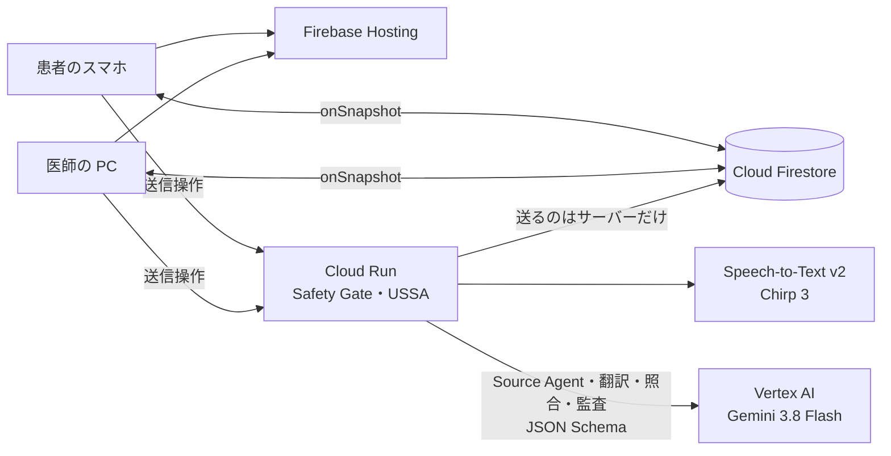

# UNSAID

**言葉を訳すだけでなく、診察で起こる「伝わったつもり」を防ぐ。**
*Beyond translation. Toward mutual understanding.*（カテゴリ：医療・福祉）

言葉の通じない診察では、訳が正しく見えても意味がずれます。
患者の「没事」は「注射は要らない」なのか「お願いします」なのか。訳から「〜しないで」が落ちていないか。
医師の「今日は結果が出るまで帰らないで」が「明日また来ればいい」と伝わっていないか。

UNSAID は Gemini と、プログラムで作った安全装置（Safety Gate）で、こうしたずれを**送る前・届いた後・会話全体**で見つけます。
確認で解消できるものは解消し、**解消できないものは確定させずに人に見せます**。診断はしません。

- 画面（医師 PC）：https://unsaid-devfest.web.app/doctor.html （患者は QR をスマホで読むだけ）
- この README の機能は `feature/unsaid-clinical-meaning` ブランチにあり、上の本番（main）にはまだ載っていません。ステージングの手順は [docs/staging.md](docs/staging.md)。

## 何をするか（UNSAID Semantic Safety Architecture）

| 問題 | UNSAID がすること | 決めるのは |
|---|---|---|
| 音声認識の誤り | 認識結果は入力欄に入るだけ。本人が確かめて直してから「送る」 | 発言者 |
| 発話意図の曖昧さ | Source Agent が直前の会話から意図を解析。「痛みはありますか？→没事」は聞かずに「痛みはありません」。「注射しましょうか？→没事」のように取り違えると危ないときだけ、**発言者本人に**意味を選んでもらう | 発言者 |
| 訳での意味の欠落・変化 | 訳を独立に照合（原文と訳文の意味の枠・直接の照合・数／日時／否定のルール）。否定・数・日時・条件・同意と拒否の取り違えを見つけたら訳し直し、残れば**自動では送らない** | Safety Gate（コード）→ 発言者 |
| 診療に必要な情報の不足 | 「头晕」の種類など、医学的に意味の分かれる所を医師に確認候補として示す（原文の根拠つき） | 医師 |
| 理解の不一致 | teach-back（自分の言葉で言い直してもらう）と、患者の言い直しと医師の指示の照合（量・回数・時間帯・日） | 医師 |
| 会話全体の矛盾・未解決 | Conversation Auditor が「前の発言との矛盾」「説明に足りない点」「理解の相違」などを、根拠の発言つきで問診メモの「未解決事項」に出す | 医師 |

区別して記録するもの: 患者が言ったこと（原文）／AI の訳／AI の解釈（意図・問診メモ・照合・監査）／本人が確認した意味／患者の追加の答え／医師の確認／まだ確認できていないこと。
**AI の確信や、複数の AI の一致を正解とはみなしません。** 「医師確認済み」「解決済み」「理解を確認済み」は医師が押したときだけです。

## 使う流れ

1. 医師が「問診を始める」→ QR。患者はスマホで読み、言語（英・中・越）を選び、AI の利用と記録の削除の説明に同意。
2. どちらも、話す（または入力）→ 文字を確かめて「送る」。**送信操作は 1 回だけ**です。
3. 意図が文脈で決まり、訳の照合で相違がなければ、そのまま相手に届きます（医師の画面には「訳を照合済み」）。
4. 意味が決まらないときは、発言者に「この発言はどの意味ですか？」（選択肢・自分の言葉で・どれでもない）。
5. 訳し直しても相違が残るときは、発言者に相違の内容を見せ、「言い直す」か「未検証として送る」（相手には未検証の印つき）。
6. 患者の発言が確認中でも、医師は「未検証の内容を見る」で原文を見られます（未検証・意味未確定と明示し、記録が残ります）。
7. 問診メモには原文の根拠つきの情報、「確認候補」、「未解決事項」。医師が質問を送る・保留・解決・無視を選びます。
8. 説明の後は「理解を確認」。食い違えば相違の箇所と再説明の文案。正しく伝わっていれば警告は出ません。
9. 「カルテにコピー」で編集してからコピー。「診察を終える」と記録はすべて消えます。

## 構成



詳しくは [ARCHITECTURE.md](ARCHITECTURE.md)（コンポーネント・状態遷移・Safety Gate）、判断の理由は [DESIGN_DECISIONS.md](DESIGN_DECISIONS.md)。

## 何を確かめたか（実測だけ）

| 確かめたこと | 結果 |
|---|---|
| API とロジックのテスト（Gemini・Firestore は偽物） | 従来 53 / 53、pytest 154 / 154、Node 11 / 11 PASS |
| 本物の画面のスクリプトでの通しテスト（偽の AI） | 38 項目 OK（意図の確認・訳し直し・発言者の確認・未解決事項・teach-back） |
| 本物のブラウザ（Chromium）での見た目（PC・スマホ） | 18 / 18 PASS（横スクロールなし・押しやすさ・カードの幅） |
| ルール層の照合（AI を使わない実測） | 誤りを入れた訳 13 / 20 を検出、正しい訳の誤警報 0 / 20 |
| 以前の確認質問（本物の Gemini、11/8） | Gemini 34 / 34 / 37、単語リスト 18（40 文×3 回） |

**まだ測っていないもの:** 本物の Gemini での 4 方式の比較（`eval/compare.py --live`、100 件を用意済み）と処理時間、本物のルールエンジンでのルールの確認、ステージングへのデプロイ、医師による医学的妥当性の評価、臨床的な有効性。詳しくは [EVALUATION.md](EVALUATION.md)。

## 動かす

```bash
pip install -r requirements.txt -r requirements-dev.txt
python test_server.py && pytest && npm test        # テスト（ネット・クレジット不要）
python -m devtools.devserver                       # ローカルで画面ごと（偽の AI）→ http://localhost:8765/doctor.html
npm i --no-save jsdom@24 && npm run e2e            # devserver を起動した状態で、画面の通しテスト
python eval/rules_eval.py                          # ルール層の実測
python eval/compare.py --live --pivot              # 本物の Gemini で 4 方式を比べる（認証が要る）
```

デモの手順は [DEMO.md](DEMO.md)、安全性は [SECURITY.md](SECURITY.md)、ステージングは [docs/staging.md](docs/staging.md)、本番のデプロイは [docs/deploy.md](docs/deploy.md)、API は [docs/api.md](docs/api.md)。

## リポジトリの中身

| パス | 中身 |
|---|---|
| `main.py` | Cloud Run の API（Safety Gate までの流れ・確認・監査・診察終了） |
| `ussa.py` | Semantic Bridge・照合のルールと統合・Safety Gate の状態遷移と最終チェック・未解決事項 |
| `clinical.py` | 問診メモ（原文との突き合わせ・情報と確認候補の状態）・teach-back の判定の集計 |
| `unsaid_ai.py` | Gemini の呼び出し（役割ごとのモデル・並列化・再試行・hedged request・予備モデル） |
| `prompts/` `schemas/` | システムプロンプトと JSON Schema（source・frame_extract・verify_compare・audit・meaning・teachback・translate） |
| `web/` | 画面（`doctor.html` `patient.html`、`clinical.js` は問診メモ・未解決事項・カルテの計算） |
| `firestore.rules` | ルール（端末は送信済みにできない） |
| `tests/` `test_server.py` `web/clinical.test.mjs` | テスト |
| `devtools/` | ローカル開発サーバー・偽の AI・ルールの書き写し・画面の通しテスト・ブラウザでの確認（本番には載らない） |
| `eval/` | 比較評価（100 件・4 方式）・ルール層の実測・以前の評価 |

## チーム Xingularity

DevFest GDGoC Japan Hackathon 2026 の作品です。デモの症例はすべて架空です。UNSAID は医療通訳の代わりになることを示したものではありません。
