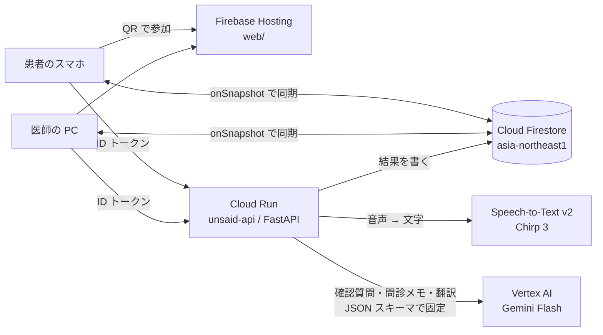

# Kumu（くむ）

**外国人患者の「あいまいな一言」を、訳す前に本人に確かめる問診支援アプリ**（カテゴリ：医療・福祉）

外国人の患者が "I've had a headache for a while" と言うと、翻訳アプリは「しばらく頭痛がします」と訳します。
医師には、それが2日なのか2か月なのか分かりません。Kumu は Gemini でこうした**意味のぶれる言い方**を見つけ、
**患者の言語で1つだけ**聞き返します。そのうえで「本人が確認済み」の内容を医師に届けます。

- 画面（医師 PC）：https://unsaid-devfest.web.app/doctor.html （患者は医師の画面の QR をスマホで読むだけ。アプリは要りません）
- API（Cloud Run）：https://unsaid-api-799163399675.asia-northeast1.run.app/health

## 使う流れ

1. 医師が「問診を始める」を押すと、QR が全画面で出ます。患者はスマホで読み、言語を選びます（英語・中国語・ベトナム語）。
2. 患者が話す（または入力する）と、Gemini が意味のぶれる語を探します。見つかれば、患者の言語で質問1つと選択肢を出します。
   - 例："I feel dizzy" →「目が回る／気が遠くなる／ふらつく」。医師にとっては、それぞれまったく違う手がかりです。
3. 患者は「医師にはこう伝わります」（逆翻訳）を自分の言語で確認してから送ります。
4. 医師の PC には、日本語訳、「本人が確認済み：しばらく → 約1週間」、整理された**問診メモ**が出ます。
5. 医師が日本語で話すと、患者のスマホに患者の言語で出ます。読み上げもできます。
6. 医師は「カルテにコピー」で問診メモを写し、「診察を終える」を押します。**この問診の記録はすべて消えます。**

**しないこと：** 診断・病名の推定・治療の提案、感情の推定、音声の保存。

## なぜ Gemini か（自分たちで測った結果）

英語・中国語・ベトナム語の40文を、デプロイ済みの API で3回ずつ流しました（[eval/results.md](eval/results.md)）。

| | 正しく扱えた数（40文中） |
|---|---|
| Gemini（このアプリ） | **34 / 34 / 37** |
| 単語リスト（「しばらく」「ときどき」などの辞書） | 18 |

単語リストには2つの弱点があります。1つは、リストに無い言い回し（"on and off"、"for ages"、时不时、mấy bữa nay）を拾えないことです。
もう1つは、文脈上聞かなくてよい語（「受付で *for a while* 待った」）にも反応して、患者に余計な質問をしてしまうことです。
Gemini は同じプロンプトのまま3言語で動き、言語を増やすときは設定を1行足すだけです。

## 構成



| 部品 | 選んだもの | 主な理由（詳しくは docs） |
|---|---|---|
| LLM | Vertex AI の Gemini Flash（`thinking_level=low`、`response_json_schema`） | 確認質問と選択肢を毎回同じ形で受け取れる。約4秒。Cloud Run と同じプロジェクト・サービスアカウントで完結する。[ai-pipeline.md](docs/ai-pipeline.md) |
| 音声入力 | Speech-to-Text v2 Chirp 3 | 文字を患者が直してから送れる。[stt.md](docs/stt.md) |
| 同期 | Cloud Firestore（onSnapshot） | 2台の画面がリアルタイムに揃う。端末ごとのポーリングが要らない |
| API | Cloud Run | Gemini の結果はサーバーだけが書く（端末の言うことをそのまま信じない）。[api.md](docs/api.md#構成の選び方own-the-why) |
| 画面 | Firebase Hosting（素の HTML / JS） | ビルド不要、QR で開くだけ |

検討して**採用しなかった**もの：単語リスト（上の表）、医療特化モデル（MedLM / MedGemma。必要なのは医学知識ではなく多言語の言い回しの理解で、提供条件・費用・「診断しない」方針とも合わない）、ブラウザの Web Speech API と Gemini への音声の直渡し（[stt.md](docs/stt.md)）。

## 安全性と運用

| 何を守るか | どうしているか |
|---|---|
| 問診の内容（医療情報） | 「診察を終える」でサーバーが発言と session をすべて消す。押し忘れても Firestore の TTL（`expireAt`）で消える。音声は保存しない |
| 読める人 | 匿名ログイン＋[firestore.rules](firestore.rules)。その診察の医師と患者の2人だけが読める。医師・患者の役割、参加は30分以内・2人まで、時刻はサーバーの時刻、をルールで縛る |
| AI の結果の改ざん | 確認質問・翻訳・問診メモはサーバー（Cloud Run のサービスアカウント）だけが書く |
| 費用の乱用 | 1つの問診で API を呼べるのは 200 回まで（`MAX_CALLS_PER_SESSION`）。Cloud Run は最大3台 |
| 遅い回・混雑 | 5秒で返らなければ同じ依頼をもう1本投げて早い方を使う（hedged request）。429 は間隔を空けて再試行し、続けば予備のモデルに切り替える |
| 止まった画面 | 二重処理を防ぐ「処理中」の印と、25秒進まなければ「もう一度」を出す仕組み |

## リポジトリの中身

| パス | 中身 |
|---|---|
| `main.py` | Cloud Run の API（`/analyze` `/translate` `/transcribe` `/end`） |
| `unsaid_ai.py` | Gemini の呼び出し（並列化・再試行・hedged request・予備モデル） |
| `prompts/` `schemas/` | システムプロンプトと JSON スキーマ |
| `stt.py` | Speech-to-Text |
| `web/` | 画面（`patient.html` `doctor.html`、共通部品 `ui.js`、Firebase とつなぐ `unsaid.js`） |
| `firestore.rules` | Firestore のルール |
| `test_server.py` | API のテスト（Gemini・Firestore は偽物。ネット不要） |
| `test.py` `bench.py` `eval/` | 実物の Gemini での確認・速度・精度の評価 |
| `smoke.py` | デプロイ後に本物の Firebase と API で端から端まで確かめる |
| `docs/` | 要件（[requirements.md](docs/requirements.md)）と設計の理由 |

## 動かす

```bash
pip install -r requirements.txt
python test_server.py          # API のテスト。「すべて PASS」と出れば OK（ネット・クレジット不要）
```

デプロイ・Firebase の設定・TTL・環境変数は [docs/deploy.md](docs/deploy.md)、画面からのつなぎ方は [docs/connect-ui.md](docs/connect-ui.md) にあります。

## チーム Xingularity

DevFest GDGoC Japan Hackathon 2026 の作品です。
