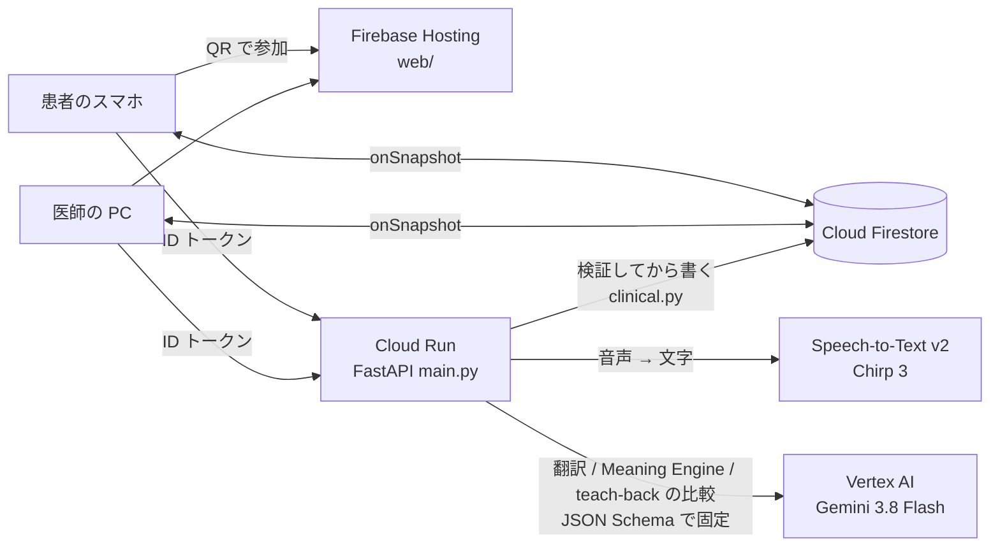

# UNSAID

**言葉を訳すだけでなく、診察で起こる「伝わったつもり」を防ぐ。**
*Beyond translation. Toward mutual understanding.*（カテゴリ：医療・福祉）

外国人の患者が「今天在车站突然觉得头晕」と言うと、翻訳アプリは「駅で突然めまいがした」と訳します。
でも中国語の「头晕」は、周りがぐるぐる回る感じなのか、ふわふわする感じなのか、気が遠くなる感じなのかで、医師が確かめることがまったく変わります。
逆に医師の「今日は結果が出るまで帰らずに待ってください」が、患者には「明日また来ればいい」と伝わっていることもあります。

UNSAID は Gemini で、患者の言葉を**原文の根拠つきで**問診メモに整理し、**医学的に意味の分かれる所**を医師に「確認候補」として示します。
医師が選んだ質問だけが患者の言語で届き、答えは元の情報に結びつきます。医師の説明は **teach-back**（患者が自分の言葉で言い直す）で、伝わったかを確かめられます。
**診断・治療の判断はしません。AI の結果は「AI 抽出」「AI 判定」のままで、医師が押したときだけ「確認済み」になります。**

- 画面（医師 PC）：https://unsaid-devfest.web.app/doctor.html （患者は医師の画面の QR をスマホで読むだけ。アプリは要りません）
- API（Cloud Run）：https://unsaid-api-799163399675.asia-northeast1.run.app/health
- この README の新機能は `feature/unsaid-clinical-meaning` ブランチにあり、上の本番にはまだ載っていません（[docs/staging.md](docs/staging.md)）。

## 5つの柱

| | 何をするか | どこで見えるか |
|---|---|---|
| **Meaning Preservation** | 患者の発言を「主訴・症状・発症・経過・性質・部位・程度・服薬・アレルギー・背景・本人の気持ち…」に整理。各項目に原文の引用（`source_quote`）を付け、**原文に実在しない引用は捨てる**（サーバーで検証） | 医師の問診メモ。項目を押すと原文・訳・状態・履歴 |
| **Ambiguity Resolution** | 医学的に意味が分かれ、医師の判断が変わりうる所だけを確認候補にする（重要な3件まで表示。もう聞いた語は出さない） | 問診メモの下の「確認候補 N件」 |
| **Mutual Understanding** | 医師が自分の説明に「理解を確認」→ 患者が自分の言葉で言い直す → Gemini が説明と比べ、食い違いを示す。正しく伝わっていれば警告は出さない | 患者の答えの下（「認識の相違の可能性」／「説明と一致」） |
| **Clinical Traceability** | 情報ごとに「AI 抽出 → 確認質問を送信 → 患者が回答 → 医師が確認」の履歴。言及なし・未確認・否定を区別 | 問診メモの詳細、カルテ用の文章 |
| **Human-in-the-Loop** | 質問を送る・編集する・保留する・無視する・自分で書く、確認済み・要修正、再説明・理解を確認済み。**すべて医師が決める** | 医師画面のボタン |

区別しているもの：**患者が言ったこと**（原文）／**AI の翻訳**／**AI の解釈**（問診メモ・確認候補・理解の判定）／**患者の追加の回答**／**医師の確認**／**まだ確認できていないこと**。

## 使う流れ

1. 医師が「問診を始める」→ QR が全画面で出ます。患者はスマホで読み、言語（英語・中国語・ベトナム語）を選び、AI の利用と記録の削除についての説明に同意します。
2. 患者が話す（または入力する）。逆翻訳（「医師にはこう伝わります」）を自分の言語で見てから送ります。
3. 医師の PC に日本語訳と**問診メモ**が出ます。曖昧な所は**確認候補**（理由・日本語の質問・選択肢）として出ます。
4. 医師が「質問を送る」と、患者のスマホに患者の言語で質問と選択肢、「分からない」「どれでもない」が出ます。自分の言葉でも答えられます。
5. 答えは問診メモの元の項目に結びつき「患者回答あり」になります（医師が押すまで「医師確認済み」にはなりません）。
6. 医師が説明したら「理解を確認」。患者の言い直しと説明が食い違えば、その箇所と再説明の文案が出ます。
7. 「カルテにコピー」で、問診メモと同じデータから作ったカルテ用の文章を**編集してから**コピー。「診察を終える」で記録はすべて消えます。

**しないこと：** 診断・病名の推定・治療の提案、感情の推定（本人がはっきり言った気持ちだけを記録）、音声の保存、医師の確認なしに AI の質問を患者へ送ること。

## 構成



| 部品 | 選んだもの | 主な理由（詳しくは [DESIGN_DECISIONS.md](DESIGN_DECISIONS.md)） |
|---|---|---|
| LLM | Vertex AI の `gemini-3.8-flash`（`thinking_level=low`、`response_json_schema`） | 多言語の言い回しの理解と、構造化出力。Cloud Run と同じサービスアカウントで完結 |
| 検証・状態 | `clinical.py`（純粋な関数） | 原文との突き合わせ・状態遷移を Gemini から切り離してテストできる |
| 音声入力 | Speech-to-Text v2 Chirp 3 | 文字を患者・医師が直してから送れる。未確定の認識結果は問診情報にしない |
| 同期 | Cloud Firestore（onSnapshot） | 2台の画面がリアルタイムに揃う。切れても自動で再接続 |
| API | Cloud Run | AI の結果と状態はサーバーだけが書く（端末の言うことをそのまま信じない） |
| 画面 | Firebase Hosting（素の HTML / JS） | ビルド不要、QR で開くだけ |

全体の設計・データの形・状態遷移は [ARCHITECTURE.md](ARCHITECTURE.md)。

## 安全性

[SECURITY.md](SECURITY.md) に詳しく書きました。要点：その診察の医師と患者の2人だけが読める（[firestore.rules](firestore.rules) とサーバーの確認の両方）、医師の操作は医師だけ、AI の結果と状態はサーバーだけが書く、患者の発言はログに出さない、「診察を終える」と TTL で記録は消える、使う前に患者の言語で同意を取る。

## 何を確かめたか（実測だけ）

| 確かめたこと | 結果 | どこ |
|---|---|---|
| API の流れ（従来の流れ・音声・診察終了・再試行・混雑） | 53 / 53 PASS | `python test_server.py` |
| 新しい流れ（シナリオ A・B・C、権限、問診どうしの分離、順番の入れ替わり、AI の失敗、状態遷移、原文との突き合わせ） | 62 / 62 PASS | `pytest` |
| 問診メモ・確認候補・カルテ用の文章（画面の計算） | 9 / 9 PASS | `npm test` |
| 本物の画面のスクリプトでシナリオ A・B・C を通す（医師と患者を別ユーザーで、偽の AI） | 33 項目すべて OK | `npm run e2e` |
| 確認質問の判断（従来の流れ）: Gemini vs 単語リスト、40文×3回 | Gemini 34 / 34 / 37、単語リスト 18 | [eval/results.md](eval/results.md)（11/8 計測） |

**まだ測っていないもの：** 新しい Meaning Engine と teach-back の比較を本物の Gemini で行う評価（`python eval/compare.py --live`）は、この作業環境に Google Cloud の認証が無かったため未実施です。臨床的な有効性は検証していません。詳しくは [EVALUATION.md](EVALUATION.md)。

## 動かす

```bash
pip install -r requirements.txt -r requirements-dev.txt
python test_server.py && pytest          # API のテスト（ネット・クレジット不要）
npm test                                 # 画面の計算のテスト（Node 20+）
python -m devtools.devserver             # ローカルで画面ごと動かす（偽の AI・メモリ上のデータ）→ http://localhost:8765/doctor.html
npm i --no-save jsdom@24 && npm run e2e  # devserver を起動した状態で、画面の通しテスト
```

デモの手順は [DEMO.md](DEMO.md)、ステージング（本番と分けた検証環境）は [docs/staging.md](docs/staging.md)、本番のデプロイは [docs/deploy.md](docs/deploy.md)、API の約束は [docs/api.md](docs/api.md)。

## リポジトリの中身

| パス | 中身 |
|---|---|
| `main.py` | Cloud Run の API |
| `clinical.py` | 原文との突き合わせ・Meaning Engine の出力の検証・状態遷移・teach-back の判定の集計 |
| `unsaid_ai.py` | Gemini の呼び出し（並列化・再試行・hedged request・予備モデル） |
| `prompts/` `schemas/` | システムプロンプトと JSON Schema（`meaning` `teachback` `translate` ほか） |
| `stt.py` | Speech-to-Text |
| `web/` | 画面（`doctor.html` `patient.html`、`clinical.js` は問診メモ・カルテの計算、`unsaid.js` は Firebase とつなぐ部品） |
| `firestore.rules` | Firestore のルール |
| `tests/` `test_server.py` `web/clinical.test.mjs` | テスト（Gemini・Firestore は偽物） |
| `devtools/` | ローカル開発サーバー・偽の AI・画面の通しテスト（本番には載らない） |
| `eval/` `test.py` `bench.py` `smoke.py` | 本物の Gemini での評価・速度・デプロイ後の端から端までの確認 |
| `docs/` | 要件・API・デプロイ・ステージング・音声入力 |

## チーム Xingularity

DevFest GDGoC Japan Hackathon 2026 の作品です。デモの症例はすべて架空です。
